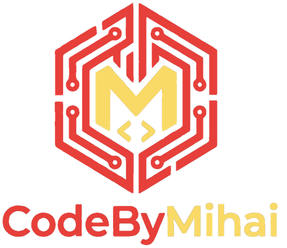
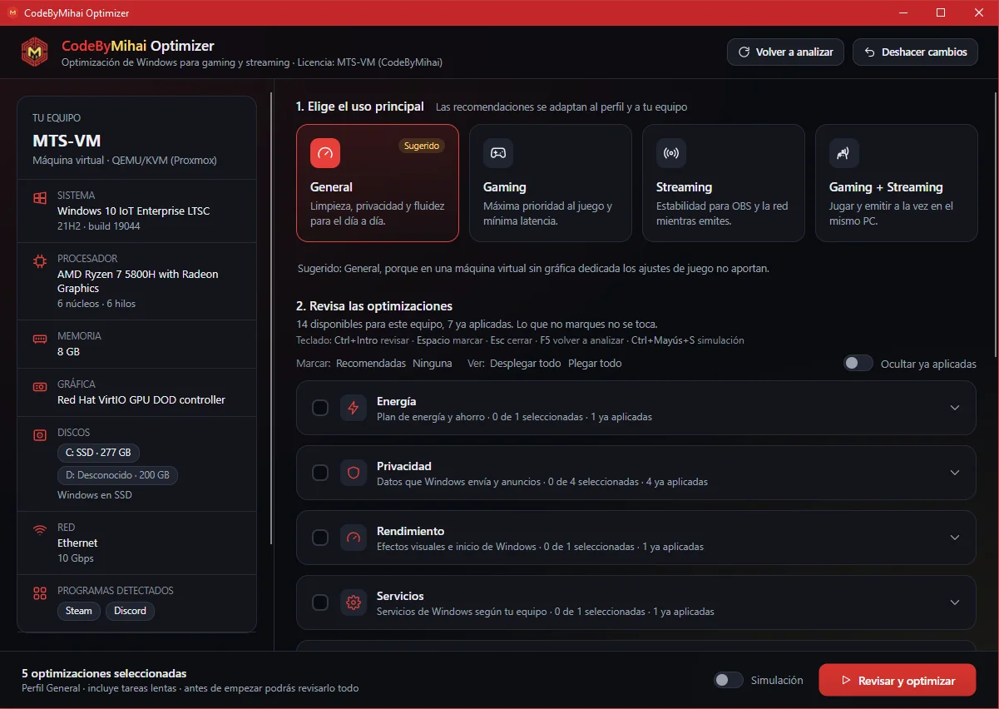
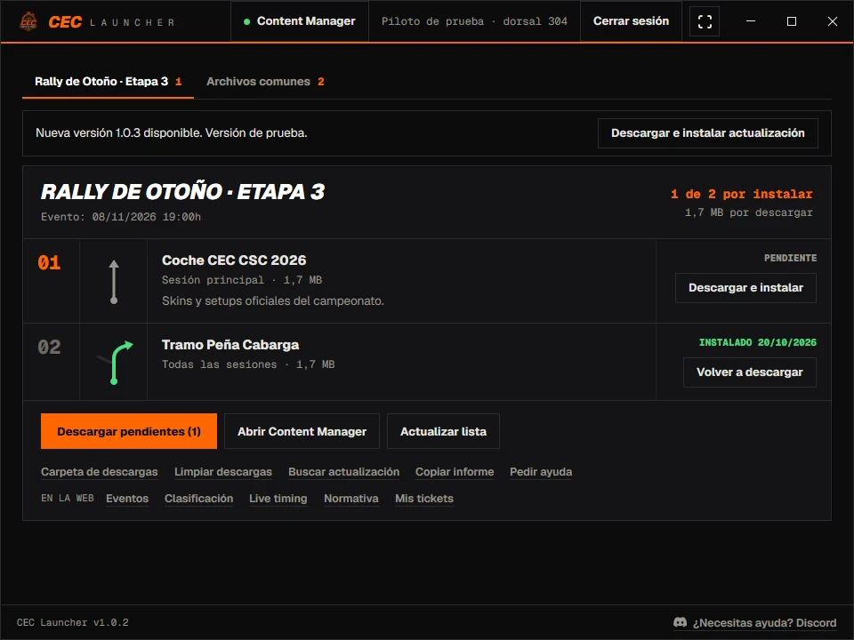
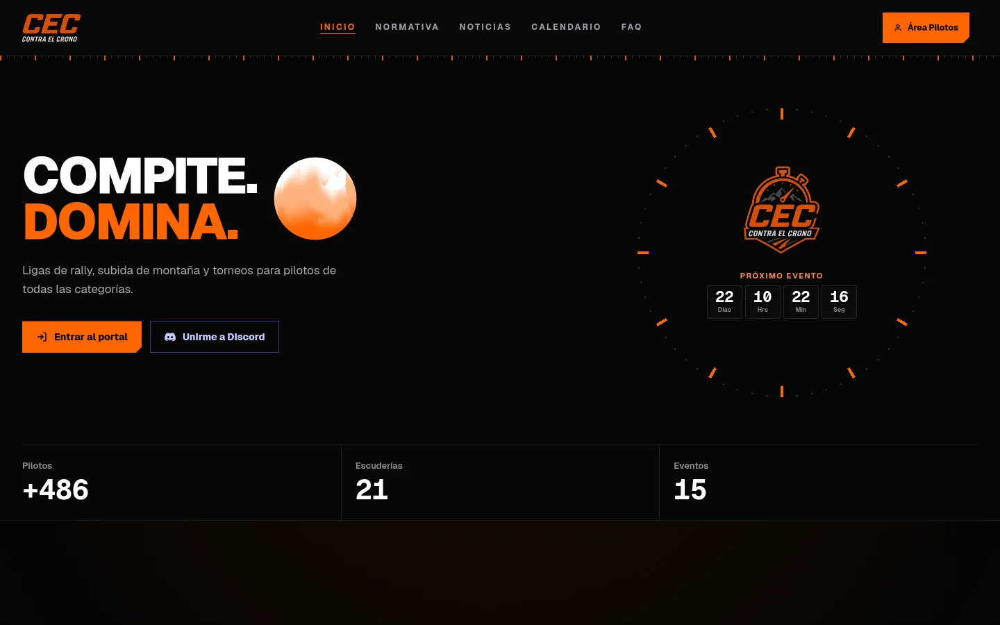

  

<h1 align="center">Portfolio</h1>

  Aplicaciones de escritorio para Windows y Linux y webs a medida. 
  Para encargar un proyecto: <a href="https://codebymihai.com"><b>codebymihai.com</b></a> · <a href="mailto:info@codebymihai.com">info@codebymihai.com</a>

  <a href="#️-codebymihai-optimizer">Optimizer</a> ·
  <a href="#-cec-launcher">CEC Launcher</a> ·
  <a href="#-contraelcronoes">contraelcrono.es</a>

---

## 🖥️ CodeByMihai Optimizer

**Optimizador de Windows y Linux para gaming y streaming.** Analiza el equipo y propone solo los ajustes que tienen sentido para su uso: general, gaming, streaming o ambos. Antes de tocar nada enseña la lista de cambios, y cada cambio se puede deshacer.

- 🔍 Detecta hardware, discos, red, monitor y programas, y avisa de lo que frena el equipo.
- 🧪 Modo simulación: muestra qué cambiaría sin cambiar nada.
- ↩️ Copia de cada cambio para deshacerlo; en Windows, además, punto de restauración.
- 🐧 En Linux funciona en Fedora, Bazzite, Arch, CachyOS, Ubuntu y Mint.
- 🔑 Licencias firmadas y ligadas a cada equipo.

> Disponible con el servicio de optimización de [CodeByMihai](https://codebymihai.com).

---

## 🏁 CEC Launcher

**El launcher del club de simracing CEC Contra el Crono.** Cada piloto ve los coches y tramos que necesita para el próximo evento de Assetto Corsa y los instala con un clic.

- 📦 Descarga, comprueba e instala los paquetes de cada evento, con pausa y reintento.
- 🚗 Abre Content Manager con el paquete listo para confirmar.
- ⏱️ Sincroniza la hora del PC por NTP para que las salidas cronometradas cuadren al segundo.
- 🐧 En Linux lanza el juego a través de Proton.

---

## 🌐 contraelcrono.es

**La web y el portal de pilotos del club CEC Contra el Crono:** ligas de rally, subida de montaña y torneos.

- 📅 Calendario, cuenta atrás al próximo evento, noticias y salón de la fama.
- 👤 Área de pilotos con perfil, inscripciones, ranking y notificaciones.
- 🛠️ Panel de administración para eventos, noticias y carreras.
- 📈 Más de 486 pilotos y 21 escuderías registrados.

👉 **[Visitar contraelcrono.es](https://contraelcrono.es)**

---

  ¿Tienes un proyecto en mente?  
  
  

